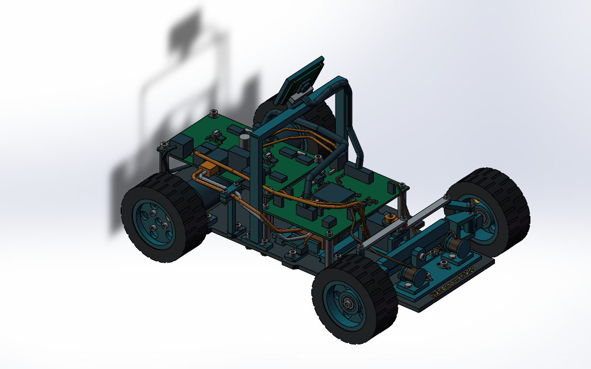
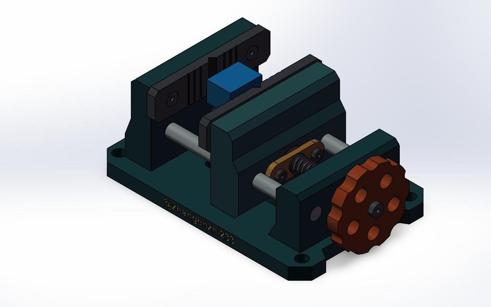

# SOLIDWORKS 机械结构设计工作流

一个用于 Codex 的机械设计技能。它从安装面、轴线和关键尺寸开始，指导建立可编辑的 SOLIDWORKS 零件与装配体，并用实际读数核对机构是否按设计运动。工作流和脚本已在 SOLIDWORKS 2024 SP5 的装配案例中验证。

## 安装

**下载 ZIP**　下载[最新安装包](https://github.com/zhangenzhi233/solidworks-mechanical-workflow/releases/latest/download/solidworks-mechanical-workflow.zip)，解压后将整个 `solidworks-mechanical-workflow` 文件夹放入 `~/.codex/skills/`。安装后应能找到 `~/.codex/skills/solidworks-mechanical-workflow/SKILL.md`。如果你设置了 `CODEX_HOME`，请使用该目录下的 `skills` 文件夹。

**使用 Git**　Windows PowerShell 可运行以下命令。

```powershell
$skillDir = if ($env:CODEX_HOME) { Join-Path $env:CODEX_HOME 'skills' } else { Join-Path $HOME '.codex/skills' }
New-Item -ItemType Directory -Path $skillDir -Force | Out-Null
git clone https://github.com/zhangenzhi233/solidworks-mechanical-workflow.git (Join-Path $skillDir 'solidworks-mechanical-workflow')
```

重新打开一个 Codex 会话，输入 `$solidworks-mechanical-workflow` 并描述你要建模或验证的机构。

> 用 $solidworks-mechanical-workflow 检查这个四轮底盘。让两前轮通过拉杆转向，并验证直行一段距离后四个车轮各转了多少度。

## 能检查什么

| 任务 | 工作流与工具 |
|---|---|
| 设计支架、外壳和接口 | 从安装基准建参数化草图，核对孔位、壁厚和装入方向。[零件与接口](references/parts.md) |
| 让装配可以拖动 | 按关节分配自由度，检查运动限位、闭环连杆和从动件位移。受力实验分别读出施力与松手后的运动。[装配与运动](references/motion.md) |
| 检查轮子有没有随车滚动 | `check_rolling.py` 用实读位移和各轮局部转角逐段复算，可以检查锁轮和方向错误。只需 Python 标准库。[输入格式与示例](references/motion.md) |
| 检查零件干涉与间隙 | `check_step_fit.py` 用 CadQuery 检查指定 STEP 实例在给定姿态下的相交体积，以及指定零件对的最小间隙。[工况示例](references/motion.md) |
| 检查装配文件能否搬走 | `inspect_sw_assembly.py` 在 Windows 上通过 pywin32 连接 SOLIDWORKS，核对当前配置实际加载的文件路径。[调用方法](references/delivery.md) |

[技能入口](SKILL.md)包含从建模到交付的完整步骤。原生装配任务使用你本机的 SOLIDWORKS 和项目模型，滚动读数检查可以独立运行。

## 可下载的原生装配样例

两个样例都在固定件上刻有 `@zhangenzhi233`。单击预览下方的说明可以查看署名近照、操作步骤和可复测的数值。下载 ZIP 后先完整解压，再用 Windows 桌面版 SOLIDWORKS 2024 打开。

| M1 四轮车 | 小台钳 |
|---|---|
|  |  |
| 推车、滑行、转向与前桥摆动。[样例说明与署名](examples/m1-car/README.md) · [下载四轮车](https://github.com/zhangenzhi233/solidworks-mechanical-workflow/releases/latest/download/M1-watermarked-SW2024.zip) | 推试块、转手轮、夹持与反弹。[样例说明与署名](examples/bench-vise/README.md) · [下载台钳](https://github.com/zhangenzhi233/solidworks-mechanical-workflow/releases/latest/download/Bench-vise-watermarked-SW2024.zip) |
