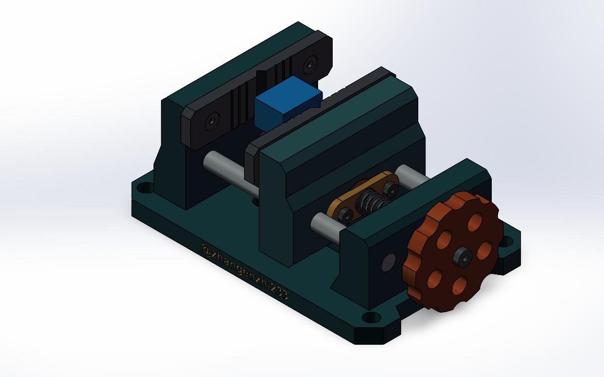

# 小台钳

[下载 SOLIDWORKS 2024 原生装配与交互程序](https://github.com/zhangenzhi233/solidworks-mechanical-workflow/releases/latest/download/Bench-vise-watermarked-SW2024.zip)

用手轮进给钳口，或推动蓝色试块，观察松手和碰撞后的运动。固定底座朝外的长侧面刻有 `@zhangenzhi233`，刻深 0.14 mm，零件特征名为“浅刻署名 zhangenzhi233”。

## 打开和上手

1. 在 Windows 本地解压整个样例文件夹。使用 SOLIDWORKS 2024 运行同目录的 **台钳手推实验.exe**。也可直接打开 `原生装配/EX-小台钳-手动与受力.SLDASM` 检查原生装配与配合。
2. 选 **活动钳口**，沿两根导杆向固定钳口拖。初始开度 22 mm，蓝块宽 12 mm，两侧各有 5 mm 空隙。活动钳口接触试块后带动它，开度到 12 mm 时两侧夹住。
3. 选 **手轮**，在轮缘上沿切向拖动。丝杆每转一圈进给 2.00 mm，四分之一圈进给 0.50 mm。
4. 点 **复位**，选 **蓝试块** 并推一下，或点 **短推 0.020 N**。松开后读数里推力归零，试块碰到钳口后反向运动。

## 接触模型

交互程序计算试块沿导杆方向的一维运动，并把结果送给原生装配。试块质量 5.184 g，导向摩擦取零，两端恢复系数取 0.10。短推的峰值速度约 57.87 mm/s，首次碰撞在约 0.094 s。面板放慢显示，方便观察松手和反弹。实物的夹紧力、丝杆自锁和零件变形需要相应的摩擦、扭矩和刚度数据。

公开包有 16 个原生文件，并附 `src` 源码。在装有 SOLIDWORKS 2024 的 Windows 上可运行 `src/build.ps1` 重建面板。

## 异目录复开验证

SOLIDWORKS 2024 SP5 从新目录加载了全部 16 个原生文件、21 个组件实例。首次打开提示需要重建（警告 32），完整重建通过。44 组装配读数覆盖短推、碰撞、手轮进给和最终夹持，首次碰撞时间为 0.094 s。[下载逐项读数](motion.csv)
