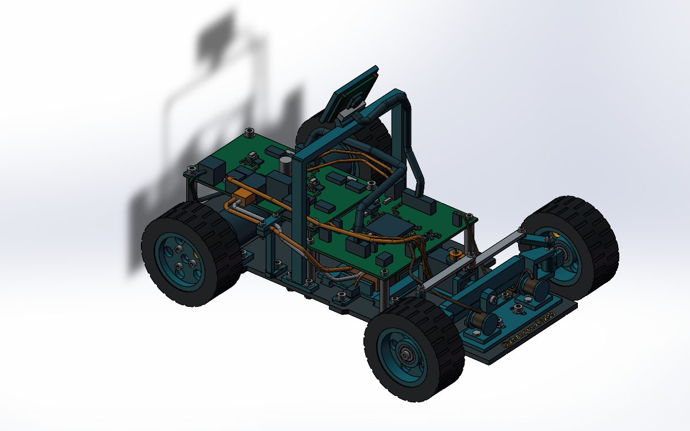

# M1 四轮车

[下载 SOLIDWORKS 2024 原生装配与交互程序](https://github.com/zhangenzhi233/solidworks-mechanical-workflow/releases/latest/download/M1-watermarked-SW2024.zip)

在装配里可以推车、转动舵臂，或单独抬起前桥。车身底板最前端的上表面刻有 `@zhangenzhi233`，从车头面向车身可以正向读出。刻深 0.14 mm，零件特征名为“浅刻署名 zhangenzhi233”。

## 打开和上手

1. 在 Windows 本地解压整个样例文件夹。使用 SOLIDWORKS 2024 运行同目录的 **M1手推与行驶.exe**，或打开 `原生装配/EX-M1-整车行驶试验.SLDASM` 查看整车。
2. 在面板点 **复位**，选择 **推车**。按住车身向前拖，松开后观察车身和轮辋继续运动。相邻路面刻线间隔 50 mm。
3. 选 **转向**，横向拖动并观察舵臂、两根拉杆和前轮。保持转向，点 **短推 1 N**，观察内、外轮的不同轮程。选 **举升摆桥** 后，向上拖动前轮可以观察前桥绕纵向支点摆动。
4. 要直接拖动原生配合，请关闭面板，打开 `原生装配/EX-M1-活动底盘.SLDASM`，在配置管理器选 **原生手拖** 或 **举升手摆**，用“移动零部件”拖动舵臂或轮端。

## 可以复测的读数

| 动作 | 读数 |
|---|---|
| 直行 47.124 mm | 半径 30 mm 的四轮各转 90°，左右轮局部轴方向相反。 |
| 舵臂右转 38° | 外侧左前轮约 24.86°，内侧右前轮约 39.25°。 |
| 短推后松手 | 力 1.00 N，持续 0.200 s，释放速度 180 mm/s，模型时间 2.000 s 时累计行进 180 mm。 |

平地演示按等效质量 1.00 kg、恒定滚阻 0.10 N 计算，由交互程序求轮程、速度与位姿，SOLIDWORKS 求解转向配合并回读实际组件变换。实车质量、轮胎与地面摩擦需要实测。样例有 106 个原生文件，车体包含 91 种零件、268 个零件实例。

公开包附有 `src` 源码。在装有 SOLIDWORKS 2024 的 Windows 上可运行 `src/build.ps1` 重建面板。

## 异目录复开验证

SOLIDWORKS 2024 SP5 从新目录加载了全部 106 个原生文件、282 个组件实例。首次打开提示需要重建（警告 32），完整重建通过。18 个工况逐项读取了车身位置、前桥摆角、转向节和四个车轮的角度。[下载逐项读数](motion.csv)
